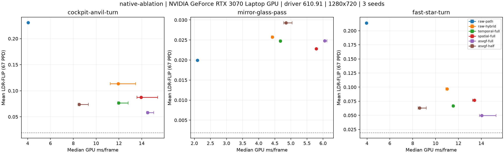
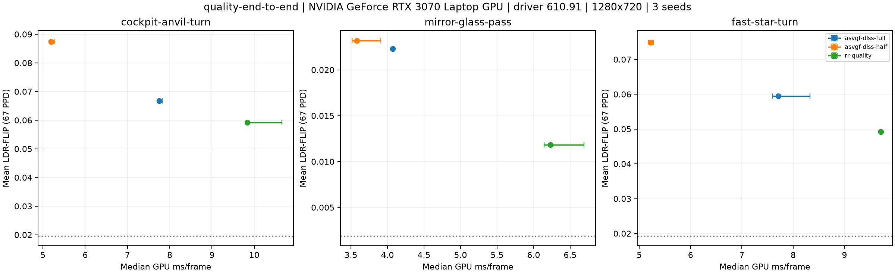
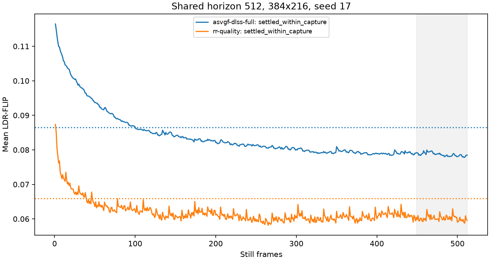

# Denoiser results: historical AC dataset

New controlled motion error/time results: [fixed-input Quality study](quality-fixed-exposure-results.md). This page preserves the historical dataset.

Current conclusions and presentation figures: [final denoiser report](final-denoiser-report.md).

Temporal-step caveat found during production-resolution lag validation:
these historical tables use wall-clock temporal inputs. DLSS/RR receive elapsed
frame intervals, so export/readback waits can alter that input. A fixed-step
validation has now completed for the separate production settling dataset;
do not present the historical Quality table or
small lag capture as fixed-step controlled results. Native upscaler-Off,
manual-exposure/effects-off rows are unaffected by this particular temporal
upscaler input. Original data remain unchanged. See the [v3 protocol](production-lag.md)
and [fixed-exposure multi-seed results](production-lag-results.md). Those new
frame-based results do not replace or revalidate the historical timing table.

The local comparison completed 81 motion runs (three shots, three seeds, nine
configurations), three repeatability controls, and two 512-frame still captures.
The dataset is `renders/formal-ac`; earlier `formal` and `formal-monitored`
directories are diagnostic only. A mid-session change from battery to AC caused
3–4x timing differences and was caught before aggregation. All published numbers
below come from the replacement AC dataset.

## Conditions and interpretation

All tables use NVIDIA GeForce RTX 3070 Laptop GPU, 8192 MiB, driver 610.91,
Release Vulkan renderer, AC power, and output 1280x720. Seeds are 17, 29 and 43.
Each GPU value is the median of three run medians; each run excludes frames 1–16.
Anvil and mirror use frames 17–81, star uses 17–61. GPU intervals cover the render
work, with trace intervals separately available in CSV. CPU initialization,
PNG writing and lag-dump wall time are not performance measurements.

FLIP is mean LDR-FLIP at 67 PPD against an independent 8192-spp endpoint reference.
It measures the last moving frame, not the average error over the entire path.
GPU time is measured over the path. Ranges in the plots are the three seed
results' minima/maxima, not confidence intervals. Panels have different axis
scales. Both configuration groups must remain separate.

## Native-resolution ablation

RTX 3070 Laptop / driver 610.91 / internal and output 1280x720 / three seeds.
Each cell is **GPU ms / FLIP**. Full and Half are A-SVGF; Half also changes the
trace budget, so its time difference is not an isolated filter cost.

| Configuration | Anvil turn | Mirror/glass pass | Fast star turn |
|---|---:|---:|---:|
| Independent raw paths | 4.031 / 0.23061 | 2.091 / 0.01996 | 3.949 / 0.21381 |
| Unfiltered hybrid | 11.942 / 0.11334 | 4.421 / 0.02572 | 11.005 / 0.09689 |
| Temporal only Full | 11.983 / 0.07661 | 4.675 / 0.02475 | 11.549 / 0.06681 |
| Spatial only Full | 13.954 / 0.08758 | 5.790 / 0.02282 | 13.405 / 0.07675 |
| A-SVGF Full | 14.528 / 0.05824 | 6.050 / 0.02481 | 14.036 / 0.04976 |
| A-SVGF Half | 8.520 / 0.07393 | 4.847 / 0.02931 | 8.602 / 0.06287 |

Full reduces endpoint FLIP relative to unfiltered hybrid by 48.6%, 3.6% and 48.6%,
at net additional frame times of 2.59, 1.63 and 3.03 ms respectively. The mirror
case is a negative finding for a uniform denoising benefit: spatial-only has lower
error than Full, and Half has higher error than the unfiltered hybrid. Raw paths
use a different integrator and must not be used to subtract an isolated hybrid
filter cost. The results do not establish whether the mirror discrepancy comes
from reconstruction, temporal history, or a transport approximation.

## Quality end-to-end comparison

RTX 3070 Laptop / driver 610.91 / 853x480 internal -> 1280x720 output / three seeds.
All three configurations use DLSS Quality, with history retained. Every RR run
passed the actual-upscaler, dimensions, history-state and evaluation-error checks.
Each cell is **GPU ms / FLIP**.

| Configuration | Anvil turn | Mirror/glass pass | Fast star turn |
|---|---:|---:|---:|
| A-SVGF Full + DLSS | 7.751 / 0.06678 | 4.071 / 0.02232 | 7.707 / 0.05948 |
| A-SVGF Half + DLSS | 5.191 / 0.08741 | 3.580 / 0.02319 | 5.215 / 0.07490 |
| DLSS-RR | 9.831 / 0.05919 | 6.228 / 0.01181 | 9.708 / 0.04925 |

Compared with Full+DLSS, RR lowers endpoint FLIP by 11.4%, 47.1% and 17.2%, for
2.08, 2.16 and 2.00 additional GPU ms. Full+DLSS is faster in all three shots;
RR's strongest error reduction is on the mirror/glass pass. These are this
machine's finite-shot tradeoffs, not a general ranking across games or hardware.

## Still capture

RTX 3070 Laptop / driver 610.91 / 256x144 internal -> 384x216 output / seed 17.
The Anvil shot performs 80 motion updates, then 512 still frames. Both methods
use the same capture length and the predeclared rule: final 64-frame median,
half-tail drift <=3%, threshold 110% of each method's terminal error, and a
suffix of at least 16 observations remaining within the threshold.

| Method | Terminal FLIP | Tail drift | Sustained entry at still frame |
|---|---:|---:|---:|
| A-SVGF Full + DLSS | 0.0786101 | 0.947% | 101 |
| DLSS-RR | 0.0599608 | 0.495% | 47 |

Both tails passed; longer 1024/2048 horizons were therefore not selected. Entry
means entry into each method's own finite terminal-error band. The earlier
128-frame check's RR value of 31 used a different terminal estimate; the extended
47-frame result supersedes it for this longer capture. This is one low-resolution
shot and one seed. It does not establish lag at 1280x720, all-shot lag, an
asymptotic error, a common-error-target latency, or seconds of interactive play.

## References, crops and verification

Independent reference-pair FLIP is 0.0195712 (Anvil), 0.00188173 (mirror) and
0.0192648 (star). The gray dotted lines show this reference discrepancy; they are
not statistical error bars or guaranteed error floors and must not be subtracted
from test-image scores. Re-scoring all 81 images against the second reference
preserved within-group method ordering. The largest change in a configuration's
median was 0.00008085. Two references still do not establish exact ground truth;
small differences, especially native Full versus RR across groups, need caution.

Fixed-coordinate crops use the median-FLIP seed for each method and label that
seed. They include raw paths, native Full, Full+DLSS, RR and the 8192-spp reference.
Different seeds and different configuration groups are explicit in the labels.
All three sheets and both comparison plots were visually checked.

- [Anvil crops](../renders/formal-ac/crops-cockpit-anvil-turn.png)
- [Mirror/glass crops](../renders/formal-ac/crops-mirror-glass-pass.png)
- [Star crops](../renders/formal-ac/crops-fast-star-turn.png)
- [All 81 runs](../renders/formal-ac/runs.csv) and [27-row summary](../renders/formal-ac/summary.csv)
- [Reference sensitivity](../renders/formal-ac/reference-sensitivity-summary.csv)
- [Lag summary](../renders/formal-ac/lag-512-summary.csv)
- [Manifest](../renders/formal-ac/manifest.json) and [verification](../renders/formal-ac/verification.json)

Ten Python checks pass. Dataset verification covers 664 saved matrix/control
artifact hashes, 6021 motion timestamps, 6976 AC/hardware samples, 3949 activity
heartbeats (largest gap 1.151 seconds), all summary medians, 1024 still scores,
and hashes of the selected lag artifacts. Clock/power captures are included;
clocks were not locked. The three initial identical RR controls were 9.91408,
9.88656 and 9.887648 ms, relative range 0.278%.

Windows counter startup occasionally returned an invalid first sample. The
collector now waits for a valid heartbeat and retries startup before rendering;
failure during rendering still rejects the run. Earlier accepted runs started
the counter asynchronously during initialization. Their streams and coverage of
the post-setup workload were audited. Logging/startup fixes did not change the
renderer, protocol, metric helper or activity thresholds; preserved manifests
and newer per-job collector hashes record the collector revisions. Transient
client interference attempts were archived and excluded, then retried.

The subsequent [full GPU regression](gpu-regression.md) ran all 50 cases: 49
passed and one ordinary-DLSS assertion remains unresolved. Shared evaluator
integration also remains pending. The local entry point reproduces the matrix, plots,
crops and small lag capture; it does not complete the separate direct-light
evaluation or the final combined-machine rerun required by the project TODO.
