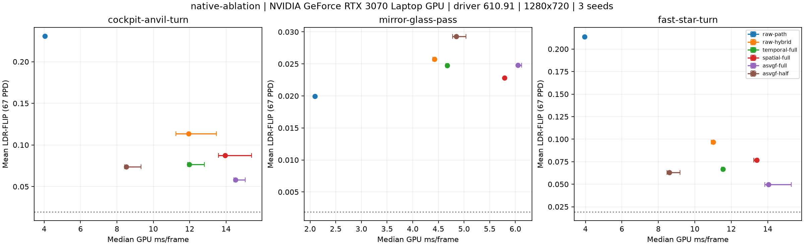
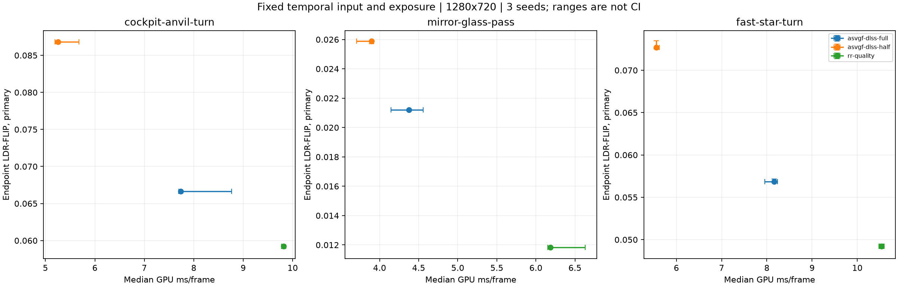
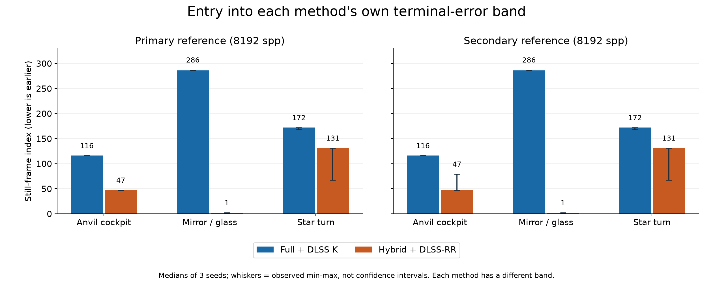
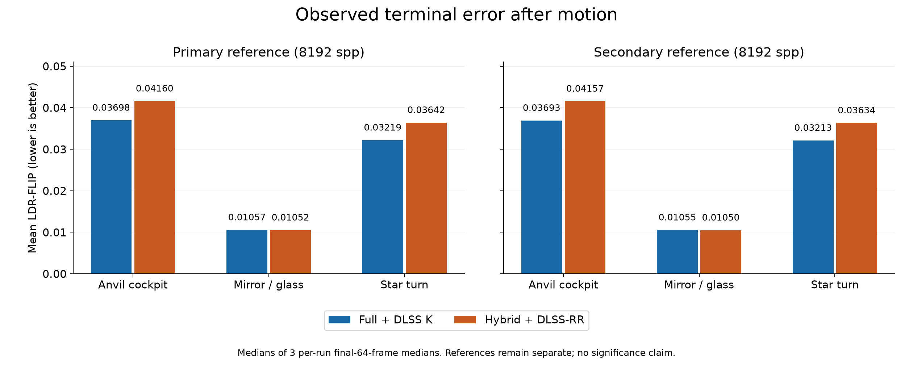

# Denoiser evaluation

The second required part of the project: our denoiser (A-SVGF) against no denoising and against
DLSS Ray Reconstruction, on three moving shots, for image error (LDR-FLIP against path-traced
references), GPU time and how long each takes to settle after the motion stops.

All numbers below come from one machine: NVIDIA GeForce RTX 3070 Laptop GPU (8 GiB), driver
610.91, Release build, on AC power, output 1280x720, seeds 17, 29 and 43. GPU times are medians
of the three seeds' per-run medians, frames 1-16 left out. Ranges are the seeds' minimum and
maximum, not confidence intervals. The summary CSVs are in [eval-denoiser/](eval-denoiser/).

## Shots and references

`StarTraveler/tools/eval/shots.json` defines the shots; `startraveler-prepare-shot` puts the
game's ship into `blue_star.yaml` at their start and end poses:

| Shot | Motion | What it stresses |
|---|---|---|
| `cockpit-anvil-turn` | 81 frames, the ship and camera turning -0.5 degrees per frame toward the Anvil | the cockpit, a changing view outside |
| `mirror-glass-pass` | 81 frames, a free camera moving (0.05, 0, -0.15) per frame past the mirror and the prism | reflection and transmission |
| `fast-star-turn` | 61 frames, turning +2 degrees per frame through the star | a fast view change, bright light |

Every shot has two references at its end pose, the GPU path tracer at 8192 spp (`--gpu -f 2048
-s 4`), seeds 1009 and 2027. Their FLIP against each other is the references' own noise:
0.01957 (Anvil), 0.00188 (mirror) and 0.01926 (star). Differences smaller than that say little.

FLIP is NVIDIA's `flip-evaluator` 1.7, LDR-FLIP at 67 pixels per degree on equal-sized sRGB PNGs,
of the last moving frame (not the mean over the path).

## Configurations

`StarTraveler/tools/eval/denoiser-protocol.json` holds them, in two groups that are never mixed
in one table:

- Native, no upscaler: independent path-traced frames (`--gpu --no-accumulation`), the hybrid
  pipeline unfiltered (`--no-temporal --no-spatial`), temporal reuse only (`--no-spatial`), the
  spatial filter only (`--no-temporal`), A-SVGF at Full and at Half trace resolution.
- Quality (853x480 rendered, 1280x720 out): A-SVGF Full or Half followed by DLSS, against
  DLSS-RR, which denoises and upscales in one (and traces every rendered pixel).

All use 1 sample per pixel, 5 bounces, exposure 1, ACES, no firefly clamp, no effects. Half also
halves the rays, so Full against Half is not the filter's cost alone.

`--no-temporal` also resets DLSS's history every frame, which is why the unfiltered and
spatial-only configurations run without an upscaler.

## Native: what each part of the filter buys

GPU ms / FLIP, three-seed medians (`native-and-quality-summary.csv`):

| Configuration | Anvil turn | Mirror/glass pass | Fast star turn |
|---|---:|---:|---:|
| Independent path-traced frames | 4.031 / 0.23061 | 2.091 / 0.01996 | 3.949 / 0.21381 |
| Hybrid, unfiltered | 11.942 / 0.11334 | 4.421 / 0.02572 | 11.005 / 0.09689 |
| Temporal reuse only, Full | 11.983 / 0.07661 | 4.675 / 0.02475 | 11.549 / 0.06681 |
| Spatial filter only, Full | 13.954 / 0.08758 | 5.790 / 0.02282 | 13.405 / 0.07675 |
| A-SVGF, Full | 14.528 / 0.05824 | 6.050 / 0.02481 | 14.036 / 0.04976 |
| A-SVGF, Half | 8.520 / 0.07393 | 4.847 / 0.02931 | 8.602 / 0.06287 |



A-SVGF at Full has 48.6%, 3.6% and 48.6% less error than the unfiltered hybrid pipeline, for
2.59, 1.63 and 3.03 ms more per frame. The mirror pass is the exception: there the spatial filter
alone beats the full filter, and Half is worse than no filter. The path-traced frames use another
integrator, so their time is not the hybrid pipeline's minus its filter.

## Quality: A-SVGF + DLSS against DLSS-RR

With a fixed time step for the temporal passes (`--frame-ms 16.667`) and DLSS's model and
exposure fixed (`--dlss-preset K --dlss-exposure 1`; DLSS-RR keeps its own):

| Shot | Configuration | GPU ms (range) | Trace ms | FLIP, reference 1 | FLIP, reference 2 |
|---|---|---:|---:|---:|---:|
| Anvil | A-SVGF Full + DLSS | 7.732 (7.700-8.766) | 4.128 | 0.06664 | 0.06669 |
| Anvil | A-SVGF Half + DLSS | 5.258 (5.194-5.679) | 1.309 | 0.08680 | 0.08681 |
| Anvil | DLSS-RR | 9.820 (9.776-9.821) | 4.164 | 0.05924 | 0.05928 |
| Mirror/glass | A-SVGF Full + DLSS | 4.376 (4.147-4.560) | 1.421 | 0.02120 | 0.02119 |
| Mirror/glass | A-SVGF Half + DLSS | 3.897 (3.704-3.898) | 0.556 | 0.02589 | 0.02588 |
| Mirror/glass | DLSS-RR | 6.185 (6.155-6.632) | 1.325 | 0.01183 | 0.01182 |
| Star turn | A-SVGF Full + DLSS | 8.160 (7.955-8.233) | 4.322 | 0.05687 | 0.05683 |
| Star turn | A-SVGF Half + DLSS | 5.553 (5.533-5.619) | 1.337 | 0.07268 | 0.07266 |
| Star turn | DLSS-RR | 10.535 (10.477-10.591) | 4.407 | 0.04924 | 0.04920 |



DLSS-RR has the least error on every shot, for 1.8-2.4 ms more than A-SVGF Full + DLSS; its
largest gain is on the mirror and the glass. A-SVGF Half + DLSS is the cheapest and has the most
error. (`quality-summary.csv`; an earlier run with wall-clock time steps and DLSS's auto exposure
gave the same ordering.)

## Settling after the motion stops

Each shot's motion followed by 512 still frames, FLIP of every still frame against both
references. For each curve, T is the median error of the last 64 frames (the two halves of those
64 within 3% of each other); the entry is the first still frame after which the error stays at
or below 1.1 T for good. Entry measures how fast a method reaches its own final error, not a
common error target, and these captures are not GPU timings.

| Shot | Configuration | Entry, median (range) | Final FLIP, reference 1 | Final FLIP, reference 2 |
|---|---|---:|---:|---:|
| Anvil | A-SVGF Full + DLSS | 116 (116-116) | 0.03698 | 0.03693 |
| Anvil | DLSS-RR | 47 (47-47; 47-79 against reference 2) | 0.04160 | 0.04157 |
| Mirror/glass | A-SVGF Full + DLSS | 286 (286-287) | 0.01057 | 0.01055 |
| Mirror/glass | DLSS-RR | 1 (1-2) | 0.01052 | 0.01050 |
| Star turn | A-SVGF Full + DLSS | 172 (168-172) | 0.03219 | 0.03213 |
| Star turn | DLSS-RR | 131 (67-131) | 0.03642 | 0.03634 |




DLSS-RR settles sooner on all three shots, but once settled A-SVGF + DLSS has less error on the
Anvil and the star (the mirror is a tie). DLSS-RR's lower error while moving and A-SVGF's lower
error at rest answer different questions; neither is better at both (`settling-summary.csv`).

## Fixes the evaluation needed

- A full scene upload now starts the previous object transforms from the current ones; before,
  the first frame of a new scene could carry false object motion (372273 moving pixels in the
  still first frame of the mirror shot, now none). A GPU test (`[initial-motion]`) checks it.
- `--frame-ms` fixes the time step the temporal upscalers and post-processing see; with the wall
  clock, writing PNGs between frames changed DLSS's input.
- `--dlss-preset` and `--dlss-exposure` fix DLSS's model and exposure, so that short and long
  runs of the same motion give the same frames.

## Running it

```powershell
python -m pip install -r StarTraveler/tools/eval/requirements.txt
python StarTraveler/tools/eval/check_measurement.py `
    --exe build/msvc/bin/Release/starcore-render.exe `
    --prepare-exe build/msvc/bin/Release/startraveler-prepare-shot.exe `
    --assets StarTraveler/assets --output renders/measurement
python StarTraveler/tools/eval/run_formal.py --exe build/msvc/bin/Release/starcore-render.exe `
    --prepare-exe build/msvc/bin/Release/startraveler-prepare-shot.exe `
    --assets StarTraveler/assets --references renders/measurement --output renders/formal
python StarTraveler/tools/eval/verify_formal.py --root renders/formal
```

`check_measurement.py` prepares the shots, renders the references and checks the timing and the
endpoints; `run_formal.py` renders every configuration on every shot with each seed (alternating
the configurations), scores them and writes `runs.csv`, `summary.csv`, the plots and crops of the
native and Quality groups. Both stop if the renderer binary changes between their runs. Nothing
else may use the GPU meanwhile (`gpu_activity.ps1` watches it).

`run_production_lag.py` (settling) and `run_quality_revalidation.py` (the fixed-input Quality
table) made the last two tables, and `verify_production_lag.py` and
`verify_quality_revalidation.py` re-check their outputs. They only run with the exact renderer
binary that passed a preflight (`validate_temporal_prefix.py`: short and long runs of a motion
give identical frames), and that preflight starts from earlier captures that are not in the
repository, so they do not yet run from a clean checkout (see `TODO.md`).

## Known issues

- On the RTX 3070 Laptop, the GPU test of ordinary DLSS at Performance with the SDK's default
  model (M there) misses its color bound (0.5097 against < 0.5, in 8-bit channel means); with
  model K it passes. On an RTX 4060 Laptop GPU (driver 617.42) the whole suite passes.

Sources: [references](references-denoiser.md); AI assistance: [record](ai-assistance.md).
