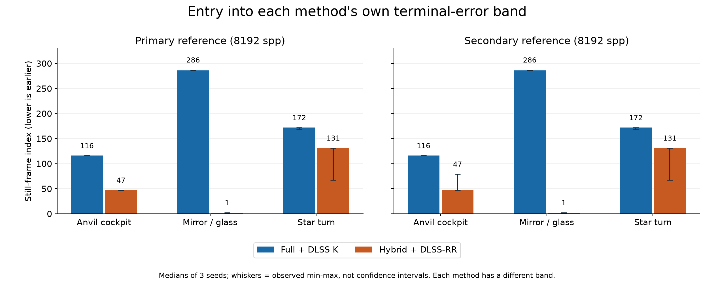
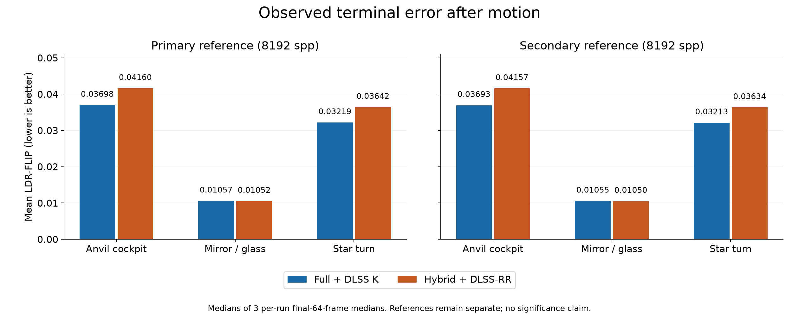
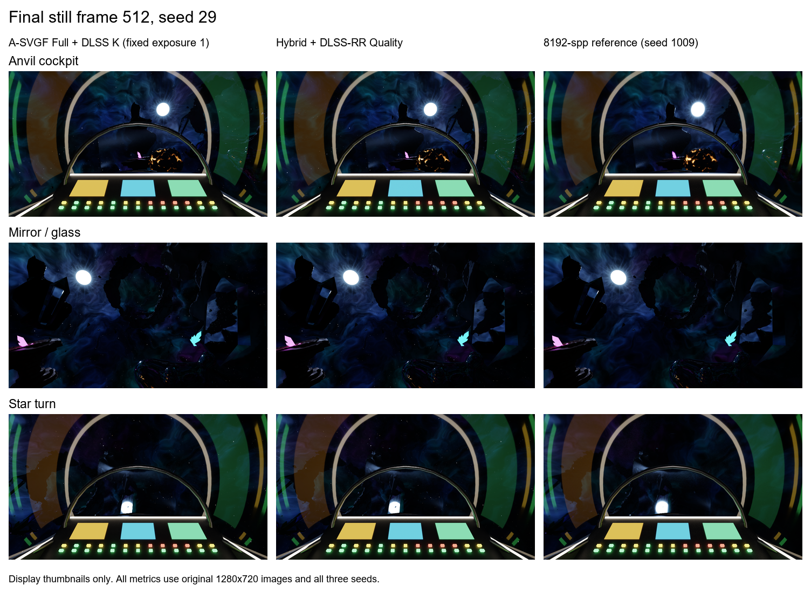

# Denoising after motion in StarTraveler

Final denoiser evaluation section, 27 November 2026. This report covers the local
denoising study. The team's direct-light evaluation and unified shared-tool run
remain separate deliverables. It does not claim the entire team project is complete.

## Research question and contribution

StarTraveler asks how much ray tracing a rasterizer needs to light a scene
convincingly in real time. This study examines the reconstruction stage: how
temporal and spatial filtering affect noisy hybrid rendering, and how Full
A-SVGF with ordinary DLSS compares with DLSS Ray Reconstruction after movement
stops. Image error, settling behavior and GPU cost answer different questions.

The renderer already supports a rasterized visibility buffer and ray-query
paths. A-SVGF reuses samples through motion-vector reprojection, detects temporal
changes and applies edge-avoiding spatial filtering. Full and Half refer to
the hybrid trace configuration; Half also changes the ray budget. Ordinary DLSS
then reconstructs the output resolution. DLSS-RR is the alternative reconstruction
path that also performs denoising. These are complete pipeline comparisons,
not an isolated measurement of one filter's cost.

The completed contribution is a reproducible, production-resolution settling
comparison with fixed temporal and exposure inputs, three motion paths, three
random seeds and two independent references. The study also found and corrected
uninitialized initial object-motion history and provided an explicit fixed
exposure option for DLSS K. These controls were necessary before collecting
comparable long and short sequences.

## Evidence sets and their scope

| Evidence | Purpose | Status and allowed use |
|---|---|---|
| Historical AC, 81 motion runs | Native ablation and original motion error/GPU-time tradeoffs | Preserved in [historical results](denoiser-results.md). Quality temporal inputs depended on wall-clock intervals and ordinary DLSS used internal auto exposure. Its Quality results remain historical; a separate fixed-input replacement is now complete. |
| Fixed-exposure production capture, 18 sequences | Settling after a reproducible motion prefix | Current headline evidence: 1280 × 720, three seeds, two references, 512 still frames. No new GPU-time comparison. |
| Fixed-input Quality comparison, 27 moving runs | Moving-path GPU cost and final moving-frame error | [Completed and independently audited](quality-fixed-exposure-results.md): Full/Half + K and RR, three seeds, dual references, three calibration sequences and three exact repeats. |
| Earlier 384 × 216 one-seed lag diagnostic | Develop and debug the measurement | Archived; superseded for production-resolution conclusions. |
| Final fixed-exposure window backup, 27 November | Illustrate the accepted seven-phase flight | [Completed and reviewed](final-window-rehearsal.md); illustrative viewport, not formal timing evidence. Manual presentation-machine checks remain open. |
| Window backup recorded 26 November | Illustrate a flight if the application fails | Predates the final exposure configuration and has a different viewport. It is not a reproduction of the current experiment. |

The historical native ablation supports the motivation for filtering. Full
A-SVGF reduced endpoint FLIP relative to unfiltered hybrid by 48.6%, 3.6% and
48.6% in Anvil, mirror and star respectively, with additional frame times of
2.59, 1.63 and 3.03 ms. These are historical measurements on the same laptop,
not timings measured by the new settling capture. The mirror result also
shows why denoising should not be assumed to improve every scene uniformly.
The original tables, exact configurations and caveats remain available unchanged.

## Controlled production experiment

All current captures use an RTX 3070 Laptop GPU with 8 GiB, driver 610.91,
Release Vulkan and AC power. Output is 1280 × 720 and both methods reconstruct
from 853 × 480 at one sample per pixel. Seeds are 17, 29 and 43. Temporal
history remains enabled. Full A-SVGF + ordinary DLSS explicitly selects model K
and `--dlss-exposure 1`. RR retains its unity-input behavior; that SR-only option
is inactive for RR. Post-processing uses manual exposure 1 with ACES/sRGB.
The simulation input is fixed at 1000/60 ms per frame. This is an input to
temporal processing, not a measured frame duration or a claim of 60 fps.

The paths are the frozen definitions in
[shots.json](../StarTraveler/tools/eval/shots.json):

| Shot | Moving prefix | Stress case |
|---|---|---|
| Anvil cockpit | 81 moving frames, 80 updates turning camera/Ship by −0.5° per update | Cockpit detail and changing exterior view |
| Mirror / glass | 81 moving frames, 80 camera/Ship translations by (0.05, 0, −0.15) | Reflection and transmission |
| Star turn | 61 moving frames, 60 turns by +2° | Rapidly changing view and bright structures |

Each prefix is followed by 512 stationary frames. The selected horizon is shared
by all six method/seed sequences for each shot and both reference comparisons.
The predeclared plan extended a shot to 1024 and then 2048 if any sequence
failed to settle. All sequences passed at 512; no extension or threshold change
was necessary. There are 18 physical captures and 36 method/seed/reference
outcomes. The two references reuse each physical capture; they are not six
independent render seeds or 36 independent experiments.

End-pose references use 8192 spp with independent seeds 1009 and 2027. LDR-FLIP
1.7 at 67 pixels per degree compares original, equal-sized sRGB images without
extra resizing or gamma conversion. The references are noisy estimates, not
exact ground truth. Their pairwise FLIP is approximately 0.01957, 0.00188 and
0.01926 for Anvil, mirror and star. These values describe reference sensitivity;
they are not confidence bounds or a statistical cutoff for method differences.

## Settling definition

For each curve, let T be the median error of the final 64 stationary frames.
The medians of the two 32-frame halves must differ by at most 3% under the
[frozen protocol](production-lag.md). Entry is the first stationary frame whose
entire remaining suffix stays at or below 1.10T, with at least 16 observations.
The displayed group entry is the median of three seeds, accompanied by the
observed minimum and maximum. Terminal FLIP is the group median of the three
per-run terminal estimates. References are analyzed separately.

This is a finite observation of entry into each method's own terminal-error
band. Since T differs between methods, entry does not measure time to equal
absolute quality. It is not asymptotic convergence, end-to-end input latency or
a GPU-time measurement. Frame export waits and CPU scoring prevent the new
captures from supporting a fresh FPS comparison.

## Results

Entries are still-frame indices, median (minimum–maximum). FLIP is lower-is-better.

| Shot | Method | Entry, primary | Entry, secondary | Terminal FLIP, primary | Terminal FLIP, secondary |
|---|---|---:|---:|---:|---:|
| Anvil | Full + DLSS K | 116 (116–116) | 116 (116–116) | 0.03698 | 0.03693 |
| Anvil | Hybrid + DLSS-RR | 47 (47–47) | 47 (47–79) | 0.04160 | 0.04157 |
| Mirror / glass | Full + DLSS K | 286 (286–287) | 286 (286–287) | 0.01057 | 0.01055 |
| Mirror / glass | Hybrid + DLSS-RR | 1 (1–2) | 1 (1–2) | 0.01052 | 0.01050 |
| Star | Full + DLSS K | 172 (168–172) | 172 (168–172) | 0.03219 | 0.03213 |
| Star | Hybrid + DLSS-RR | 131 (67–131) | 131 (67–131) | 0.03642 | 0.03634 |

RR enters its own band earlier on all three measured paths. Mirror RR is already
near its eventual error band when movement stops: its 1–2-frame entry follows
80 motion updates with accumulated history. Calling this one-frame latency
would be incorrect. Star RR ranges from 67 to 131 frames, making the seed
variation material even though the median is earlier than Full + DLSS K.

Full + DLSS K has lower observed terminal FLIP on Anvil and star. Mirror terminal
estimates are close. The second reference preserves these descriptive orderings
but moves one Anvil RR entry from 47 to 79, leaving its group median at 47.
Earlier band entry therefore does not establish a universal quality advantage.
The data support a scene-dependent tradeoff between adaptation to a method's
own eventual state and the error of that state.

The sheet uses seed 29 and stationary frame 512 for both methods. Its thumbnails
are for illustration. All statistics use all three seeds and original 720p
images. The [full curves](../renders/production-lag-fixed-exposure/convergence.png)
retain every seed and both references.

## Measurement repairs and validation

The production preflight originally found different motion prefixes when only
the length of the stationary tail changed. A full scene upload now initializes
previous object transforms from current transforms. Nonzero stationary initial
motion pixels fell from 372273 to zero. This repair alone did not resolve the
auto-exposure controls. The explicit DLSS K exposure input provides a working
controlled alternative. We do not claim to have uniquely identified an
undocumented SDK-internal cause.

With fixed exposure, every one of the 80 moving PNGs matches between the short
and long preflight sequences. Timed/dumped endpoint equality, fixed temporal
inputs, exposure records and three native-reference compatibility controls also
pass. Both CLIs and the game's Render panel expose the new control. Its default
remains the previous internal auto path; positive fixed exposure requires K.

The normal renderer, game and GPU-test targets build. The completed checks are
109 CPU/game cases and three focused GPU regressions with synchronization
validation. The full 54-case GPU suite was not rerun. The deferred Performance-M
color test still reports 0.509729445 against <0.5 in its helper's 8-bit
channel-mean units. This is not FLIP. Neither that threshold nor any convergence
threshold was relaxed, and the issue is not claimed fixed.

Independent verification checks 10536 PNG hashes, 10554 state rows, all 36
outcomes and all 12 summary rows. It directly recomputes 36 FLIP samples with
maximum difference zero. There are 9216 scored stationary images and 18432
reference comparisons. Command/source and runtime audits preserve provenance.
The vendor DLL audit compares before/after identities with an earlier module
probe; it is not per-capture tracing. See the [detailed evidence report](production-lag-results.md).

## Fixed-input Quality error and GPU cost

The separate [27-run Quality study](quality-fixed-exposure-results.md) now supplies
controlled moving-path GPU timestamps and moving endpoint error at 1280 x 720.
RR has lower final moving-frame FLIP than Full/Half + K on all three paths against
both references, with higher whole-frame GPU time. Full + K is between Half + K
and RR on these measures. This does not contradict the stationary terminal-error
result: motion endpoints and post-stop terminal images answer different questions.
The linked report preserves all seed ranges and both references; the presentation
adds two untimed appendix charts. All original numerical limits remain unchanged.

## Limits, conclusion and remaining work

Three seeds on one GPU and three paths support descriptive comparisons, not a
significance test, confidence interval or general claim about every GPU or scene.
This experiment does not compare equal GPU budgets, temporal flicker, HDR-FLIP
or a common absolute-error target. Reference noise remains visible. The new
Quality configuration must not inherit the historical timing numbers.

For these paths RR reaches its own terminal band earlier, while Full + DLSS K
has lower observed terminal error in two shots and mirror terminal values are
close. Presenting both measures preserves the useful result without asserting
a single winner. Fixed temporal inputs, exposure and initialization are part of
the experiment, not incidental implementation details.

Remaining project work includes
upstream shared-evaluator integration and unified direct-light/denoiser run,
the deferred M diagnostic, and manual controls/projection/playback checks
on the presentation setup. The [fixed-exposure automatic window rehearsal
and backup video](final-window-rehearsal.md) are now complete. These are explicitly outside the completed settling
study and this report integration.

## Sources, reproducibility and AI disclosure

Background and software references are collected in the
[verified local bibliography](references-denoiser.md), with a separate
[AI assistance record](ai-assistance.md) for the team's course submission review.

The numerical sources are the preserved [summary CSV](../renders/production-lag-fixed-exposure/summary.csv),
[per-seed/reference CSV](../renders/production-lag-fixed-exposure/runs.csv),
[verification](../renders/production-lag-fixed-exposure/verification.json),
[manifest](../renders/production-lag-fixed-exposure/manifest.json) and historical
[AC report](denoiser-results.md). [Renderer documentation](gpu-rendering.md)
describes the implementation. [Protocol](production-lag.md) specifies the exact
criterion and collection commands. The report figures are reproducible with
`../.build-tools/eval-venv/Scripts/python.exe StarTraveler/tools/eval/build_final_materials.py`.
This command reads the frozen summary and never rerenders or changes captures.

AI assistance: Codex assisted with implementation, diagnostics, evaluation
automation, checks, figures and this report/presentation draft. Scientific claims
are tied to the recorded artifacts above. This disclosure describes assistance;
it does not replace the team's final authorship review or the proposal's method
bibliography. The denoiser results must be merged with the other team sections
before representing the complete project report.
