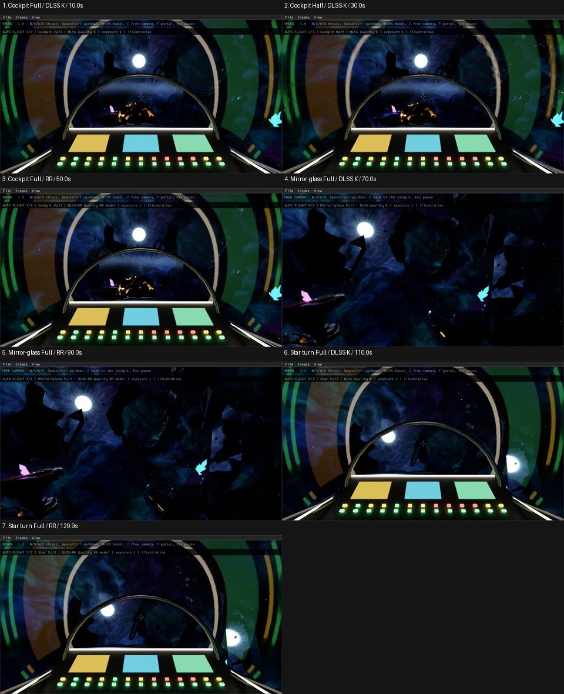

# Final fixed-exposure window rehearsal

Accepted 27 November 2026. Use this recording as the current visual backup:
[flight.mp4](../renders/window-rehearsal/backup-fixed-exposure/flight.mp4).
It shows the real GLFW/Vulkan game window captured through DXGI, driven by the
automatic flight route. It is not an offscreen image sequence or a manual
keyboard rehearsal.

## Recording and chapters

The silent H.264 video is 139.87 seconds, 1280 × 720, 30 fps, 4196 decoded frames,
79,284,715 bytes (75.61 MiB). The 22-pixel menu leaves a 1280 × 698 render viewport,
reconstructed from 853 × 465. These dimensions differ from the 1280 × 720
viewport / 853 × 480 internal formal dataset. Encoding at 30 fps does not measure
the renderer's performance.

| Approximate video time | View and configuration |
|---|---|
| 0–20 s | Anvil cockpit, Full A-SVGF + DLSS K |
| 20–40 s | Anvil cockpit, Half A-SVGF + DLSS K, additional ray-budget illustration |
| 40–60 s | Anvil cockpit, Full + DLSS-RR |
| 60–80 s | Mirror / glass, Full A-SVGF + DLSS K |
| 80–100 s | Mirror / glass, Full + DLSS-RR |
| 100–120 s | Star turn, Full A-SVGF + DLSS K |
| 120–139.87 s | Star turn, Full + DLSS-RR |

Exact observed chapter boundaries and review samples are in
[chapters.csv](../renders/window-rehearsal/backup-fixed-exposure/chapters.csv).
Each phase resets pose and history, moves for its first 80%, then holds the view.
The Full/K and RR star stages now use the same trace-resolution setting.
The extra cockpit Half stage is not part of the two-method settling table.



## Final settings

- DLSS Quality, explicit ordinary model K and fixed DLSS HDR exposure 1.
  RR retains its unity input; the SR-specific exposure field is inactive there.
- Manual tone-map exposure 1, ACES/sRGB, one sample per pixel, five bounces,
  seed 29, firefly clamp 0, temporal history retained.
- Fixed 1000/60 ms temporal-processing input. Flight physics and phase duration
  follow the real window clock, with the existing stall cap. This route does
  not reproduce the headless benchmark's per-frame motion increments.
- Post effects, engine particles and space dust are disabled for this route.
  Ordinary play retains its defaults when automatic rehearsal is not selected.
- RTX 3070 Laptop, driver 610.91, Release Vulkan, AC power confirmed.

The HUD labels the method, trace resolution, fixed exposure and illustrative
flight. Each one-second log sample records the actual active upscaler and
dimensions plus exposure, temporal step, tone mapper, samples, seed and trace
configuration. All 141 samples pass the fixed-configuration checks. No fallback
or renderer evaluation error was accepted.

## Checks and evidence

The updated game builds. Its freshly linked game test executable passes 14 cases
and 119 assertions. The headless renderer binary still matches the frozen formal
renderer hash. This task does not claim a new full GPU regression or a new timing
study, and does not change any image-error or convergence threshold.

A 21.23-second desktop calibration passes before the full take. The first attempt
under restricted desktop access was rejected by Windows; it is retained as a
failed attempt and was not used. Desktop access was then granted for recording.
Seven injected configuration errors are rejected: auto exposure, SR exposure,
temporal step, trace resolution, active upscaler, seed and output dimensions.

The complete final video decodes successfully. The original scene-change checks
pass, and assistant inspection of all seven full-size phase samples confirms
the expected views, labels, unobscured game window and changing landmarks.
Additional early/late image checks find movement within every phase, excluding
HUD text. Every phase has four logged stationary camera/yaw samples near its end.
These checks detect frozen captures and confirm camera holds; they are not a
perceptual-quality score or proof of pixel-identical method trajectories.

- [Capture command, binary/source/assets and process completion](../renders/window-rehearsal/backup-fixed-exposure/manifest.json)
- [Full decode, scene changes and fixed configuration](../renders/window-rehearsal/backup-fixed-exposure/verification.json)
- [Per-phase image movement and logged camera holds](../renders/window-rehearsal/backup-fixed-exposure/motion-verification.json)
- [Visual acceptance and scope](../renders/window-rehearsal/backup-fixed-exposure/review.json)
- [Frozen source/executable audit](../renders/window-rehearsal/backup-fixed-exposure/provenance.json)
- [Calibration negative controls](../renders/window-rehearsal/fixed-exposure-desktop-calibration/negative-control-checks.json)

The earlier [26 November recording](../renders/window-rehearsal/backup-dxgi/flight.mp4)
is preserved as historical material. Use the new fixed-exposure backup for the
current presentation. The new video supplements the [formal settling evidence](production-lag-results.md)
and does not replace it.

## Presentation use and remaining manual rehearsal

The seven-phase video is about 2 minutes 20 seconds and has no narration. Use
selected chapters alongside the [12-minute script](final-materials/speaker-script.md),
or budget this playback inside the final rehearsal. Playing the whole clip on
top of a 12-minute talk uses about 14 minutes 20 seconds before questions.

If the game fails, show the saved video and report figures. Say that the flight
illustrates the pipelines and the figures provide the controlled measurements.
Do not quote live counters or the movie's encoding frame rate as new results.

Before presenting, a person still needs to verify manual W/S/A/D and camera
controls, projector visibility (especially the dark mirror view and small HUD),
video playback on that computer and spoken/audio timing. Automatic window
flight cannot certify those checks. No game or recorder is left running.

## Reproduce a fresh take

Run from the repository root on an unlocked desktop with access to screen capture.
Keep the game window unobscured and on the primary monitor. Choose a fresh output
folder, retain AC power, and check account quota while the process runs.

```powershell
../.build-tools/eval-venv/Scripts/python.exe StarTraveler/tools/eval/record_rehearsal.py `
  --exe build/msvc-vs2022/bin/Release/StarTraveler.exe `
  --output renders/window-rehearsal/new-fixed-take --seconds 20 `
  --pause-file renders/window-rehearsal/fixed-exposure.pause.request
../.build-tools/eval-venv/Scripts/python.exe StarTraveler/tools/eval/verify_rehearsal_video.py `
  --root renders/window-rehearsal/new-fixed-take
../.build-tools/eval-venv/Scripts/python.exe StarTraveler/tools/eval/verify_rehearsal_motion.py `
  --root renders/window-rehearsal/new-fixed-take
```

The extra motion verifier expects the full-length take, not the short calibration.
Writing `renders/window-rehearsal/fixed-exposure.pause.request` stops the owned
game and finalizes a partial recording. Partial takes are not accepted backups.
The supervising agent checks both Codex quota windows and stops at either limit;
the recording helper does not query account quota itself.
