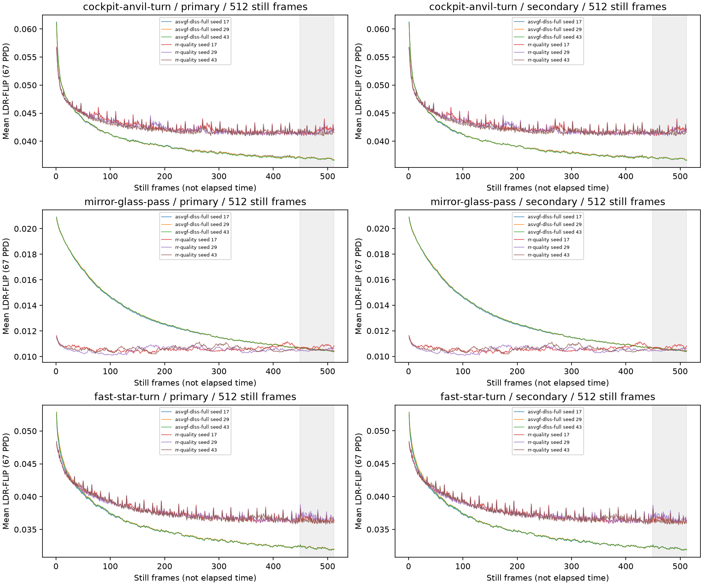
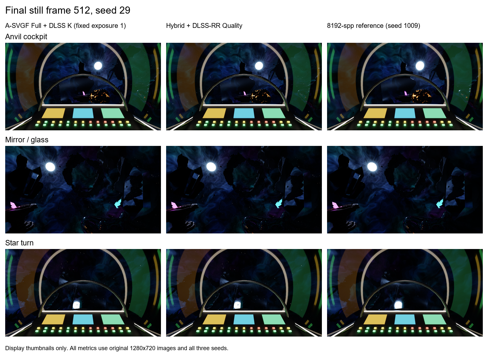

# Production-resolution settling results (fixed exposure)

Presentation-ready interpretation is in the [final report](final-denoiser-report.md),
with [summary figures and editable slides](final-materials/README.md).

Completed on 2026-11-27: all 18 physical captures and 36 method/seed/reference
outcomes pass the predeclared finite-capture rule. All three shots select the
initial shared horizon of 512 still frames; no 1024/2048 extension or threshold
change was needed. This is a separate dataset from the historical 81-run motion
quality/timing table and the earlier diagnostic lag captures.

## Conditions

RTX 3070 Laptop GPU, driver 610.91, Release Vulkan, AC power throughout rendering.
Output 1280 x 720, internal 853 x 480, 1 spp, seeds 17/29/43. Both methods retain temporal
history and use a fixed 1000/60 ms simulation input. Ordinary DLSS explicitly uses
K with `--dlss-exposure 1`; tone mapping is manual exposure 1, ACES/sRGB. RR keeps
its original unity-input behavior; the SR-only exposure field is inactive there.
Each curve is compared separately against 8192-spp end-pose references seeded 1009
and 2027, using LDR-FLIP 1.7 at 67 PPD with no resizing or extra gamma conversion.

The terminal estimate is the final 64-frame median. Its two half-window medians
must drift by at most 3%. Entry is the first still frame whose entire remaining
suffix stays at or below 110% of that estimate, with at least 16 observations.
The criterion is unchanged. See [protocol](production-lag.md).

## Results

Entry cells are the three-seed median (minimum–maximum), measured from the first
still frame. Terminal cells are the three-seed median of each run's final 64-frame
FLIP median. Lower FLIP is better. Primary and secondary references are not pooled.

| Shot | Method | Entry: primary | Entry: secondary | Terminal FLIP: primary | Terminal FLIP: secondary |
|---|---|---:|---:|---:|---:|
| Anvil cockpit | Full + DLSS K | 116 (116–116) | 116 (116–116) | 0.03698 | 0.03693 |
| Anvil cockpit | Hybrid + DLSS-RR | 47 (47–47) | 47 (47–79) | 0.04160 | 0.04157 |
| Mirror / glass | Full + DLSS K | 286 (286–287) | 286 (286–287) | 0.01057 | 0.01055 |
| Mirror / glass | Hybrid + DLSS-RR | 1 (1–2) | 1 (1–2) | 0.01052 | 0.01050 |
| Star turn | Full + DLSS K | 172 (168–172) | 172 (168–172) | 0.03219 | 0.03213 |
| Star turn | Hybrid + DLSS-RR | 131 (67–131) | 131 (67–131) | 0.03642 | 0.03634 |

RR reaches its own terminal-error band earlier on these paths. The 1–2-frame
mirror result means its motion history was already near its eventual band when
movement stopped; it is not a one-frame end-to-end latency measurement. This
relative-band test does not measure time to a common absolute error target.

Full + DLSS has lower observed terminal FLIP on Anvil and star; the mirror
terminal estimates are close. A faster band entry alone does not imply a lower
error. The second reference changes one Anvil RR seed's entry from 47 to 79 frames;
its group median remains 47. Star RR varies 67–131 frames across seeds. Both
reference outcomes and every seed are retained, including these differences.

These are finite 512-frame observations on one GPU with three seeds, not an
asymptotic-convergence proof, confidence interval or significance test. Native
reference noise remains part of the comparison. Export waits and CPU scoring
make these captures unsuitable for a new GPU-time or FPS comparison. The old
Quality table remains historical. The separate [fixed-input 27-run replacement](quality-fixed-exposure-results.md) is now complete; its moving endpoints and timings are distinct from these stationary captures.



The gray region is the 64-frame terminal-estimation window. All individual curves
are shown. The following display-only thumbnails use the same illustrative seed 29
and final still frame 512; all reported statistics use original 720p images and
all three seeds.



## Implementation and verification

`UpscalerSettings.dlssExposure` defaults to 0, preserving ordinary DLSS's previous
internal auto-exposure path. Positive values require explicit K, allocate a 1 x 1
R32F normalization texture and disable internal auto exposure. Changing the value
waits for queued work, recreates the feature and resets history once. Both CLIs
and the game's Render panel expose this control. The frame CSV records the
active SR exposure, or 0 for auto/inactive SR. Post-processing exposure is separate.

The initial-transform fix also remains: a full upload initializes previous
object transforms from the current upload. Real stationary first-frame Motion
pixels fall from 372273 nonzero to 0. Together, the clean production preflight
passes all 80 moving PNG comparisons, timed/dumped endpoint equality, state/time/
exposure checks, and three native reference compatibility controls. Earlier auto
controls reproduced mismatches; this establishes a working controlled option,
not a uniquely proven SDK-internal cause.

The normal renderer, game and GPU-test builds pass. 109 CPU/game cases and three
focused GPU regressions pass with synchronization validation: fixed-exposure
color/history/reset/readback, initial object motion, and fixed temporal inputs.
The original color bounds 6 and 0.5 are unchanged. Four invalid CLI combinations
are rejected before GPU creation. The full 54-case GPU suite was not rerun; the
previously deferred ordinary Performance-M issue is not claimed resolved.

Independent verification passes all 10536 moving/still PNG hashes and 10554
capture-state rows, recomputes all 36 outcomes and 12 group summaries, and checks
36 direct FLIP samples against the batch scores with maximum difference 0.
There are 9216 scored still PNGs and 18432 reference comparisons. Supplemental
audit confirms 36 effective commands, executable/source identity, fixed flags,
and equality of every final PNG with its final dumped frame. Visual inspection
of the curve plot and final-frame sheet found matching poses and no blank or
corrupt examples.

Source, executable and executable-directory runtime files are frozen in the run's
`source-snapshot`. NGX SDK/driver file hashes were separately checked after this
run against an earlier loaded-module probe and match; this is a before/after
provenance check, not module tracing during each capture. See the vendor audit.

## Artifacts and reproduction

- [Run and per-seed/reference outcomes](../renders/production-lag-fixed-exposure/runs.csv)
- [Three-seed summaries](../renders/production-lag-fixed-exposure/summary.csv)
- [Independent verification](../renders/production-lag-fixed-exposure/verification.json)
- [Command/source audit](../renders/production-lag-fixed-exposure/supplemental-audit.json)
- [Vendor runtime audit](../renders/production-lag-fixed-exposure/vendor-runtime-audit.json)
- [Complete capture/curve manifest](../renders/production-lag-fixed-exposure/manifest.json)
- [Clean fixed-exposure preflight](../renders/fixed-exposure-validation/manifest.json)

From the repository root, resume an interrupted run with the same frozen inputs:

```powershell
../.build-tools/eval-venv/Scripts/python.exe StarTraveler/tools/eval/run_production_lag.py `
  --exe build/msvc-vs2022/bin/Release/starcore-render.exe --workers 4
```

For this completed run, audit it without rerendering:

```powershell
../.build-tools/eval-venv/Scripts/python.exe StarTraveler/tools/eval/verify_production_lag.py
```

Changed binaries, configuration, references or collection helpers require a
fresh preflight/output directory. Preserve all earlier diagnostic data. The
collector does not query Codex account quota: its supervising agent must check
both usage windows and write `pause.request` at either limit; the subprocess and
CPU workers then stop. Completed data and score checkpoints are retained.
