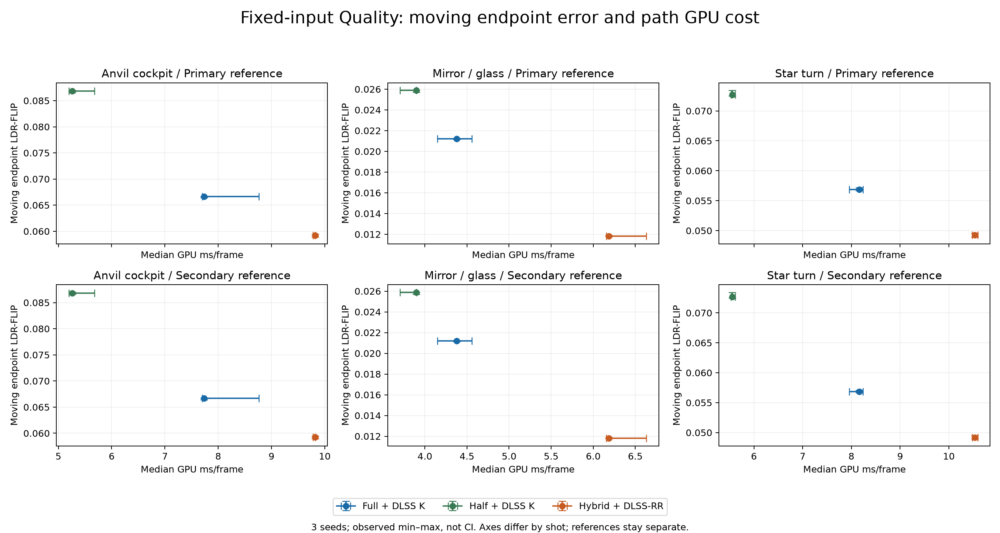

# Fixed-input Quality error and timing results

Completed 27 November 2026. This new study replaces the historical Quality
table for discussion of the final fixed-input configuration. It does not turn
the preserved historical wall-clock/auto-exposure table into a controlled one.

Output 1280x720, internal 853x480, 1 spp, five bounces, seeds 17/29/43, fixed
1000/60 ms temporal input, manual tone-map exposure 1, ACES/sRGB, no effects or
clamp. Full/Half A-SVGF explicitly use DLSS K exposure 1; RR retains unity input.
RTX 3070 Laptop, driver 610.91, Release Vulkan, AC power. The three methods
rotate launch positions across seed rounds. See the [protocol](quality-revalidation.md).

GPU and trace numbers are three-seed medians of per-run medians after excluding
the first 16 frames. Image error is the final MOVING frame against each separate
8192-spp reference, not average path error or post-stop terminal error. Three-seed
ranges are observed min–max, not confidence intervals. No significance claim is made.

| Shot | Method | GPU ms, median (range) | Trace ms, median | Moving FLIP, primary | Moving FLIP, secondary | Seeds |
|---|---|---:|---:|---:|---:|---:|
| Anvil cockpit | Full + DLSS K | 7.732 (7.700–8.766) | 4.128 | 0.06664 | 0.06669 | 3 |
| Anvil cockpit | Half + DLSS K | 5.258 (5.194–5.679) | 1.309 | 0.08680 | 0.08681 | 3 |
| Anvil cockpit | Hybrid + DLSS-RR | 9.820 (9.776–9.821) | 4.164 | 0.05924 | 0.05928 | 3 |
| Mirror / glass | Full + DLSS K | 4.376 (4.147–4.560) | 1.421 | 0.02120 | 0.02119 | 3 |
| Mirror / glass | Half + DLSS K | 3.897 (3.704–3.898) | 0.556 | 0.02589 | 0.02588 | 3 |
| Mirror / glass | Hybrid + DLSS-RR | 6.185 (6.155–6.632) | 1.325 | 0.01183 | 0.01182 | 3 |
| Star turn | Full + DLSS K | 8.160 (7.955–8.233) | 4.322 | 0.05687 | 0.05683 | 3 |
| Star turn | Half + DLSS K | 5.553 (5.533–5.619) | 1.337 | 0.07268 | 0.07266 | 3 |
| Star turn | Hybrid + DLSS-RR | 10.535 (10.477–10.591) | 4.407 | 0.04924 | 0.04920 | 3 |

- Anvil cockpit: RR minus Full+K is +2.088 GPU ms and -0.00741 primary endpoint FLIP (descriptive group medians).
- Mirror / glass: RR minus Full+K is +1.810 GPU ms and -0.00937 primary endpoint FLIP (descriptive group medians).
- Star turn: RR minus Full+K is +2.375 GPU ms and -0.00763 primary endpoint FLIP (descriptive group medians).

Full/Half also changes ray budget; the difference does not isolate filter cost.
These endpoint/cost results and the [post-stop settling results](production-lag-results.md)
answer different questions. Earlier entry into a method's own terminal band
does not imply lower terminal error, moving endpoint error, or GPU cost.
Reference noise remains part of all comparisons.

All 27 main runs, three RR calibration sequences and three exact endpoint repeat
controls pass. The independent audit recomputes all 54 reference scores, checks
commands, fixed inputs, state/history, timestamps, AC power, source hashes and
GPU activity/counter coverage, and recomputes all nine summary rows. Attempts
rejected for background activity remain archived; their results are not included.
All original numerical limits are unchanged. The deferred Performance-M fixture
remains unresolved, and this is not a new full GPU-suite pass.

- [Per-seed results](../renders/quality-fixed-exposure/runs.csv)
- [Summary](../renders/quality-fixed-exposure/summary.csv)
- [Independent verification](../renders/quality-fixed-exposure/verification.json)
- [Manifest, inputs and calibration](../renders/quality-fixed-exposure/manifest.json)
- [Vendor identity check](../renders/quality-fixed-exposure/vendor-runtime-check.json)
- [Fresh upstream check](../renders/quality-fixed-exposure/upstream-check.json)

The figures' source CSV is copied without precision loss beside them. The slide
appendix uses primary-reference medians rounded to eight decimals in editable
chart workbooks for portability, displayed to two GPU-ms/five FLIP decimals.
Both references and seed ranges remain in the report/CSV. Software and method
citations are in the [bibliography](references-denoiser.md).
